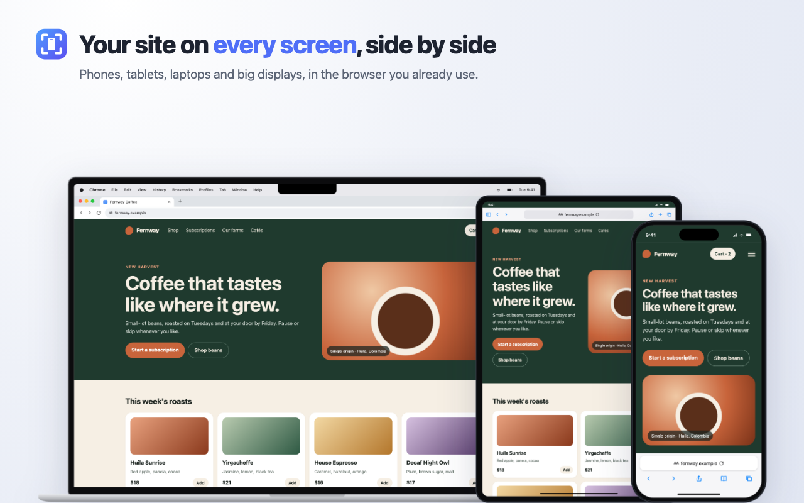

<p align="center"></p>

<h1 align="center">view-sim</h1>

<p align="center">See your site on phones, tablets, MacBooks and big displays, side by side, framed in the browser your users actually use. Take transparent screenshots, or let an agent drive it over MCP.</p>

<p align="center">
  <a href="LICENSE"></a>
  <a href="https://github.com/itelo/view-sim/releases"></a>
  <a href="https://www.npmjs.com/package/view-sim-mcp"></a>
  <a href="https://github.com/sponsors/itelo"></a>
</p>

<p align="center"></p>

| Get it | |
| --- | --- |
| Chrome, Edge, Brave | Download the zip from [releases](https://github.com/itelo/view-sim/releases) and load it unpacked ([details](#install-the-extension)). Store listings are on the way. |
| Firefox, Zen | Load `extension/manifest.json` as a temporary add-on ([details](#install-the-extension)). Add-ons listing on the way. |
| Claude Code and other MCP clients | `claude mcp add view-sim -- npx -y view-sim-mcp` ([details](#mcp-server)) |

- **Real device sizes.** iPhone 15 Pro, 15 Pro Max, 13 mini and SE; Pixel 8; Galaxy S23; iPad mini; iPad Pro 11"; MacBook Pro 14" and 16"; iMac 24"; Dell UltraSharp 40" ultrawide. Each device gets the page area left after its status bar and browser bars, so iPhone 15 Pro in Safari is 393 × 659, as on the phone.
- **The browser around the page.** Safari, Chrome, Firefox or Zen per device, with that browser's bars, tabs and user agent.
- **Phone behaviour.** Mobile user agents, touch events, drag-to-scroll, hidden scrollbars and a touch cursor, all inside your normal browser and your signed-in session.
- **Transparent screenshots.** PNGs of the device with its frame, the screen, or only the page.
- **An MCP server.** Agents such as Claude Code can open sites on devices, navigate and take screenshots through the extension, or render headlessly with Playwright and real device emulation, with no window at all.

```
extension/    the browser extension (Chrome, Zen, Firefox)
mcp-server/   the MCP server: bridge to the extension, plus the headless renderer
tools/        icon renderer, demo site, store images, packaging and test harness
store/        store listing text and images
docs/         images for this README
```

## Install the extension

**Chrome:** open `chrome://extensions`, turn on Developer mode, click **Load unpacked** and pick `extension/`. Or download `view-sim-extension-<version>.zip` from the [releases](https://github.com/itelo/view-sim/releases), unzip it and load that folder.

**Zen or Firefox (128+):** open `about:debugging#/runtime/this-firefox`, click **Load Temporary Add-on…** and pick `extension/manifest.json`. The add-on is removed when the browser quits.

**Site access.** view-sim asks for nothing at install. The first time you turn it on for a site, the popup asks for access to that site only. To take screenshots, also click **Allow access to all websites** in the extension's settings: browsers only let an extension capture a tab when it has that permission. If you click the camera without it, the settings page opens.

## Using it

Open a site, click the toolbar button and flip the switch. Every page of that site then opens in the simulator until you turn it off.

- **Devices:** iPhone 15 Pro, 15 Pro Max, 13 mini and SE; Pixel 8; Galaxy S23; iPad mini; iPad Pro 11"; MacBook Pro 14" and 16"; iMac 24"; and Dell UltraSharp 40" (U4025QW, 2560×1080).
- **Browsers, per device:** the browser picker next to the device name changes the interface drawn around the page, and it sets what the page gets on mobile devices: user agent, `navigator.vendor` and `userAgentData`.

  | | iPhone | iPad | Android | Mac / display |
  | --- | --- | --- | --- | --- |
  | Safari | status bar on top; address bar and toolbar at the bottom | one bar on top | — | macOS menu bar and Safari toolbar |
  | Chrome | address bar on top, toolbar at the bottom | one bar on top | address bar on top, gesture bar at the bottom | tab strip and address bar |
  | Firefox | address bar on top, toolbar at the bottom | one bar on top | address bar at the bottom | tab strip and address bar |
  | Zen | — | — | — | vertical tabs in a sidebar, page in a rounded card |

  The page area is what is left after the system and browser bars. For example, iPhone 15 Pro in Safari gets 393 × 659, the same as the real phone. Rotated phones show a compact bar on top.
- **Screenshots:** click the camera button on a device. It saves a PNG with a transparent background: the device with its frame, or the screen with status bar and browser bars when **Frame** is off. ⌥-click saves only the web page. While it captures, the device is shown alone and as large as the window allows. Chrome saves at screen resolution; Firefox and Zen render the device at 2× its real size.
- **Desktops** keep your browser's real user agent, mouse input and scrollbars. Only `screen.*` and `devicePixelRatio` are changed.

## MCP server

The extension connects out to a local server on `ws://127.0.0.1:47820`. The server accepts only connections from extension pages and speaks MCP over stdio to your agent.

```bash
claude mcp add view-sim -- npx -y view-sim-mcp
```

Add `--scope user` to have it in every project. From a clone of this repo instead:

```bash
cd mcp-server && npm install
claude mcp add view-sim --scope user -- node "$(pwd)/index.mjs"
```

**Only let view-sim connect.** By default any browser extension may connect to the bridge, and the server says so on stderr when it starts. To allow only view-sim, set `VIEW_SIM_EXTENSION_IDS` to its extension id, comma-separated for several browsers: in Chrome the 32-letter id shown on `chrome://extensions`, in Firefox and Zen the add-on id `view-sim@itelo`. In Chrome the id is also checked against the connection's origin, which other extensions cannot fake.

```bash
claude mcp add view-sim -e VIEW_SIM_EXTENSION_IDS=abcdefghijklmnopabcdefghijklmnop,view-sim@itelo -- npx -y view-sim-mcp
```

Tools:

| Tool | What it does |
| --- | --- |
| `view_sim_status` | Shows whether the extension is connected, plus every simulator tab with its devices, URLs and page sizes |
| `view_sim_list_devices` | Lists device ids, screen sizes and the browsers each device supports |
| `view_sim_open` | Opens a URL in a new tab on the given devices, e.g. `[{"id":"iphone-15-pro","browser":"safari"},"pixel-8"]`, and waits for them to load |
| `view_sim_set_devices` | Replaces the devices in a tab |
| `view_sim_navigate` | Loads a URL or path on the devices and waits |
| `view_sim_set_options` | Sets zoom, frame and sync |
| `view_sim_screenshot` | Captures one device or all of them from the extension's tab, as `device`, `screen` or `viewport`; returns images and can also save PNGs with `save_dir` |
| `view_sim_headless_screenshot` | Renders a URL on devices with no browser window and no extension (see below) |
| `view_sim_turn_off` | Turns the simulator off for a hostname |

### Headless screenshots

`view_sim_headless_screenshot` doesn't need the extension or a browser window. It loads the page with Playwright using real device emulation: viewport, pixel ratio, touch, mobile mode and user agent, so CSS `pointer: coarse` and the viewport meta tag behave as they do on a phone. Then it draws the device around the result with the same simulator code and CSS the extension uses. Safari devices render in WebKit; the other browsers render in Chromium, with their own interface and user agent. It needs Playwright's browsers once:

```bash
npx -y playwright@1.64.1 install chromium webkit
```

(From a clone: `cd mcp-server && npm run install-browsers`.)

Headless pages start signed out. For pages behind a login, pass `storage_state`: a Playwright storage-state JSON file with the cookies and localStorage to use.

### Transparent backgrounds

`device` and `screen` images are PNGs with a transparent background, from both tools. The headless renderer draws on a transparent page. The extension captures the device twice, on black and on white, and works out each pixel's transparency from the difference, so rounded corners and anti-aliased edges stay clean. `viewport` images are the page itself, so they have no transparent areas.

Notes:
- The browser must be running with the extension loaded. After the server starts, the extension can take up to 30 seconds to connect; the first call waits for it. The connection status is on the extension's settings page, where the bridge can also be turned off.
- Screenshots bring the simulator tab and its window to the front, because browsers only capture what is on screen. macOS can refuse to bring a background app forward; if a screenshot reports that the tab "has no size on screen", click into the browser window once and retry.
- In Firefox and Zen, an idle background page is stopped after 30 seconds. An open simulator tab keeps it running, so the bridge stays connected while you work.
- `open` needs the extension to already have access to the site: turn the site on once from the toolbar button, or allow access to all websites in the settings.
- `screenshot` needs access to all websites, as above.
- Only one server can hold the port. A second agent session's server keeps retrying, and its tools report that the port is taken.

## How it works

| Piece | What it does |
| --- | --- |
| `extension/background.js` | Keeps the list of enabled sites. It registers the content scripts and one `declarativeNetRequest` rule per site; the rule sets the first device's user agent on the simulator's frames and strips `X-Frame-Options` and `CSP` from their responses. It also crops screenshots and runs the MCP bridge. |
| `extension/simulator/` | Runs at `document_start` in the top frame. It stops the page, replaces it with the simulator UI, and loads the same URL in one iframe per device. |
| `extension/frame/frame-main.js` | Runs in the page's own JavaScript context inside those iframes. It overrides the user agent and screen properties, emulates touch input and hides scrollbars on mobile devices, and reports navigation back to the simulator. |
| `mcp-server/index.mjs` | The MCP server and the WebSocket bridge. |

## Limitations

- CSS media queries such as `(pointer: coarse)` still see a desktop. Only JS `matchMedia` is changed. Width-based queries work, because each iframe really has the device's width.
- The server sees the user agent of the first device in the list; each frame's JavaScript sees its own.
- If a device frame navigates to another site, that frame loses the emulation, unless that site is turned on too.
- Pages that need to be top-level, such as some OAuth or payment flows, may break inside the frame.

## Support view-sim

view-sim is free and MIT licensed. If it saves you time, you can support it on [GitHub Sponsors](https://github.com/sponsors/itelo). There is also a small link in the popup and on the settings page; the extension never asks.

## Privacy

view-sim collects no data. It only talks to `127.0.0.1:47820` when the MCP bridge is on. See [PRIVACY.md](PRIVACY.md).

## Dev

- `node tools/make-icons.mjs` renders `extension/icons/logo.svg` to the toolbar PNGs. It uses the MCP server's Playwright, so run `npm install` in `mcp-server/` first.
- `tools/demo-site/` is a small page to try the extension on: serve the project root and open `http://localhost:4580/tools/demo-site/`.
- `tools/harness.html` runs the simulator without the extension runtime, with `chrome.*` stubbed. Serve the project root with `python3 -m http.server 4580`, then open `http://localhost:4580/tools/harness.html`.
- `node tools/store-images.mjs` renders the README images in `docs/` and the store images in `store/images/` from `tools/demo-site/showcase.html`.
- `node tools/smoke-test.mjs` renders one device headlessly and checks the image; CI runs it with the extension lint on every push.
- `node tools/package-extension.mjs` zips `extension/` into `dist/view-sim-extension-<version>.zip` for the stores. Pushing a `v<version>` tag that matches `extension/manifest.json` runs `.github/workflows/release.yml`, which lints, zips and attaches the zip to a GitHub release.
- `npm pack` in `mcp-server/` copies the extension files the headless renderer needs into `mcp-server/vendor/` first, so the npm package works on its own. In the repo the renderer reads `extension/` directly.

## License

[MIT](LICENSE) © itelo
